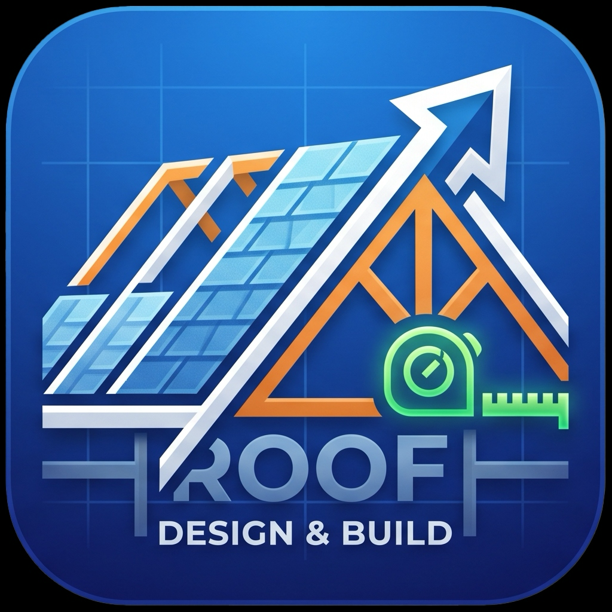

<div align="center">



# RoofMaster Pro

### **Next-Generation 3D CAD & Structural Metal Roofing Estimation Suite**

[](LICENSE)
[](https://react.dev/)
[](https://www.typescriptlang.org/)
[](https://threejs.org/)
[](https://www.electronjs.org/)
[](https://vitejs.dev/)
[](https://github.com/pooriarr/roofing)

<p align="center">
  <b>RoofMaster Pro</b> is an engineering-grade desktop and web application engineered for architects, civil engineers, roofing contractors, and fabricators. It delivers real-time 3D parametric visualization, interactive 2D blueprint drafting, structural metal panel optimization, and automated Bill of Materials (BOM) cost calculations.
</p>

[Key Features](#-key-features) •
[Tech Stack](#-technology-stack) •
[Installation & Setup](#-getting-started) •
[Building Releases](#-building-desktop-executables) •
[Project Architecture](#-project-architecture) •
[Internationalization](#-internationalization-i18n)

---

</div>

## 🌟 Key Features

### 1. 🏗️ Parametric 3D WebGL Roof Visualizer
- **Real-Time 3D Rendering**: Built on Three.js with hardware-accelerated WebGL lighting, shadows, and realistic metallic shingle shaders.
- **Parametric Geometry**: Dynamically modify roof length, width, pitch, overhang, and truss heights with instant updates.
- **Interactive Camera Controls**: 360° orbit, pan, zoom, wireframe toggle, and perspective/orthographic viewing modes.

### 2. 📐 2D CAD Blueprint & Custom Profile Designer
- **Vector Drafting Canvas**: High-precision CAD canvas featuring grid snapping, dimensioning lines, and angle callouts.
- **Metal Profile Editor**: Design standing seam, corrugated, ribbed, and custom sheet geometries with live bending calculations.
- **Panel Layout & Waste Minimization**: Computes optimal panel cuts and overlaps to eliminate scrap materials.

### 3. 🔩 Structural Fastener Pattern Optimizer
- **Smart Screw Calculation**: Calculates exact fastener counts based on purlin spacing and panel rib profiles.
- **Wind Uplift & Zone Modeling**: Visualizes density variations for perimeter, corner, and field fastening zones.

### 4. 📊 Automated Bill of Materials (BOM) & Cost Estimating
- **Full Quantity Takeoff**: Generates exact counts for roof panels, ridge caps, gutters, underlayment membranes, fasteners, and flashing.
- **Detailed Financial Reporting**: Custom cost per unit, tax calculations, labor costs, overhead markup, and exportable project estimates.
- **Print & PDF Export**: Instant professional client quote generation.

### 5. 🌐 Built-in Multi-Language & RTL Engine
- Seamlessly translated into **8 languages** with bidirectional LTR/RTL layout support:
  - 🇬🇧 English (`en`)
  - 🇮🇷 فارسی (`fa` - RTL)
  - 🇩🇪 Deutsch (`de`)
  - 🇫🇷 Français (`fr`)
  - 🇪🇸 Español (`es`)
  - 🇮🇹 Italiano (`it`)
  - 🇹🇷 Türkçe (`tr`)
  - 🇸🇦 العربية (`ar` - RTL)

---

## 💻 Technology Stack

| Domain | Technology / Library | Purpose |
| :--- | :--- | :--- |
| **UI Framework** | [React 19](https://react.dev/) | Declarative component architecture |
| **Language** | [TypeScript](https://www.typescriptlang.org/) | Type-safe enterprise code quality |
| **Build Tooling** | [Vite](https://vitejs.dev/) | Lightning-fast HMR and optimized bundler |
| **3D Engine** | [Three.js](https://threejs.org/) | WebGL 3D rendering pipeline & cameras |
| **Desktop Runtime** | [Electron 43](https://www.electronjs.org/) | Cross-platform native application framework |
| **Packaging** | [electron-builder](https://www.electron.build/) | Code signing, DMG, NSIS installer generator |
| **Icons & Design** | [Lucide React](https://lucide.dev/) | Modern, clean vector iconography |
| **Code Quality** | [Oxlint](https://oxc.rs/) | Rust-powered high-performance linter |

---

## 🚀 Getting Started

### Prerequisites
- **Node.js**: `v20.x` or higher recommended
- **npm**: `v10.x` or higher

### 1. Clone Repository
```bash
git clone https://github.com/pooriarr/roofing.git
cd roofing
```

### 2. Install Dependencies
```bash
npm install
```

### 3. Run Development Server (Web)
```bash
npm run dev
```
Open [http://localhost:5173](http://localhost:5173) in your browser.

### 4. Run Desktop Application (Electron)
```bash
npm run electron:start
```

---

## 📦 Building Desktop Executables

RoofMaster Pro is configured with `electron-builder` to produce production-ready desktop binaries:

### macOS (`.dmg` & `.zip`)
```bash
# Build for Apple Silicon (M1/M2/M3/M4)
npm run build:mac:arm64

# Build for Intel x64
npm run build:mac:x64

# Universal Binary
npm run build:mac:universal
```

### Windows (`.exe` NSIS Installer & Portable)
```bash
# Build NSIS installer & portable EXE
npm run build:win

# Build only portable executable
npm run build:win:portable
```

Artifacts are output to the `release/` directory.

---

## 📂 Project Architecture

```plaintext
roofing/
├── build/                 # Native application icons (icns, ico, png sets)
├── electron/              # Electron main & preload scripts
│   ├── main.cjs           # Native window manager & IPC handlers
│   └── preload.cjs        # Secure context bridge
├── public/                # Public assets, web manifests & icons
├── src/
│   ├── assets/            # Graphics, logos, and illustrations
│   ├── components/        # Core React components
│   │   ├── Blueprint2D.tsx          # 2D CAD architectural plan viewer
│   │   ├── CADProfileDesigner.tsx   # Custom sheet profile editor
│   │   ├── InstallationGuide.tsx    # Construction workflow guides
│   │   ├── ProfileDesigner2D.tsx    # Cross-section panel visualizer
│   │   ├── ProjectReport.tsx        # BOM & invoice generation
│   │   ├── Sidebar.tsx              # Input parameter controls
│   │   └── Visualizer3D.tsx         # Parametric Three.js 3D viewport
│   ├── utils/
│   │   ├── calculator.ts            # Structural & material calculation math
│   │   ├── fastenerPattern.ts       # Fastener distribution algorithms
│   │   └── translations.ts          # Multi-language dictionary & RTL handlers
│   ├── App.tsx            # Main application orchestrator
│   ├── index.css          # Design system & CSS tokens
│   └── main.tsx           # React DOM root entry
├── package.json           # Project manifest & build scripts
├── tsconfig.json          # TypeScript configurations
└── vite.config.ts         # Vite build configuration
```

---

## 📄 License

This project is licensed under the [MIT License](LICENSE) - see the [LICENSE](LICENSE) file for details.

---

<div align="center">
  <sub>Developed with ❤️ by <a href="https://github.com/pooriarr">PooriaR</a></sub>
</div>
